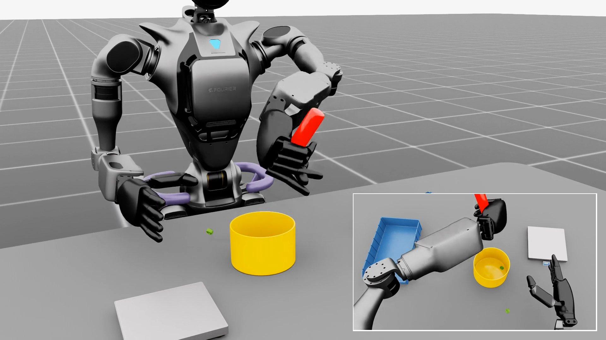
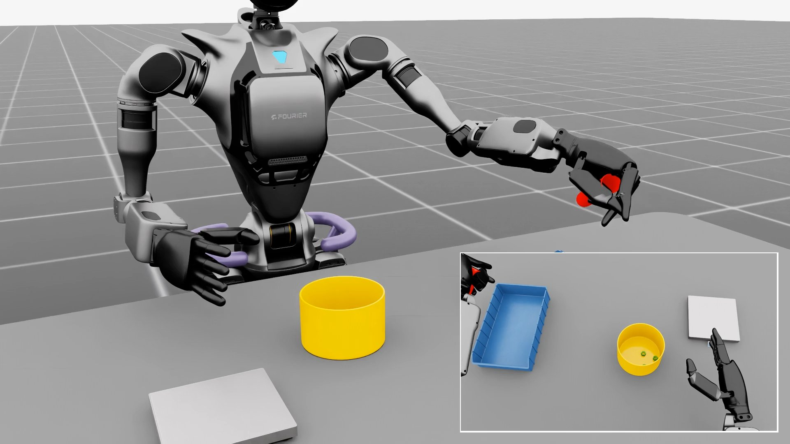
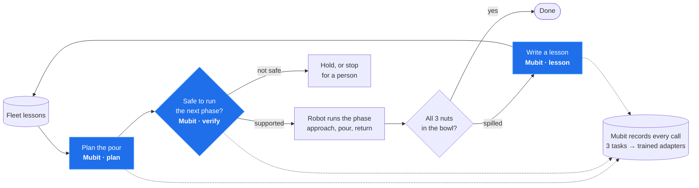
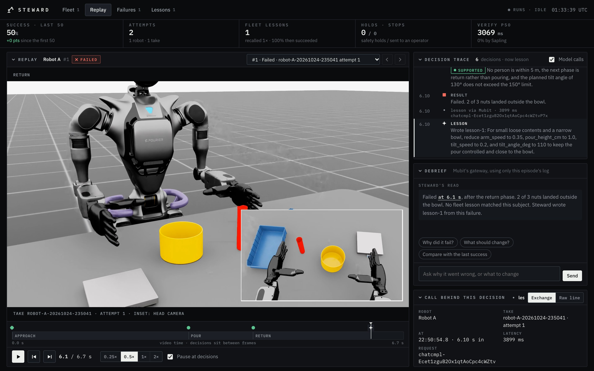
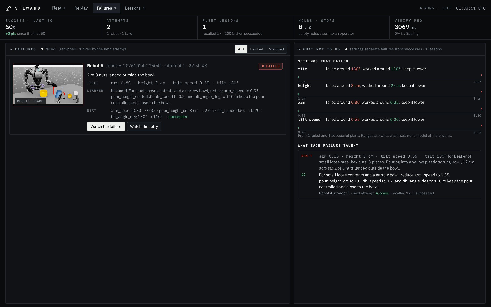

<h1 align="center">Steward</h1>

<p align="center">
  <b>One robot's mistake becomes the whole fleet's lesson.</b><br>
  A governing layer between a robot's AI planner and its motors, with every decision made through
  <b>Mubit</b>. It remembers every failure, checks every plan against written safety rules before
  anything moves, and turns the fleet's corrections into training data for Mubit's task-specific models.
</p>

<table>
  <tr>
    <td width="50%"></td>
    <td width="50%"></td>
  </tr>
  <tr>
    <td align="center"><b>Attempt 1.</b> Pours fast. <b>2 of 3 nuts miss the bowl.</b></td>
    <td align="center"><b>Attempt 2.</b> Reads the lesson, pours slower. <b>3 of 3 land.</b></td>
  </tr>
</table>

<p align="center"><sub>One real, uncut take: a Fourier GR-1 humanoid in NVIDIA Isaac Sim. Every plan, safety check and lesson in it is a live AI call through Mubit.</sub></p>

<table align="center">
  <tr>
    <td align="center"><h3>3/11 → 8/11</h3>first tries that landed<br>vs retries with a lesson</td>
    <td align="center"><h3>11/11</h3>takes succeeded<br>within three attempts</td>
    <td align="center"><h3>0/21</h3>unsafe plans approved<br>by our safety verifier</td>
    <td align="center"><h3>830+</h3>live AI calls<br>routed through Mubit</td>
  </tr>
</table>

---

## How Mubit is used

**Every decision the robot makes is an AI call through Mubit.** The settings it uses, the go or
no-go before every move, and every lesson it writes all come from these calls. Here's one attempt,
with each Mubit call in blue:



Each attempt makes **one plan call, one safety check before each of the three phases, and one
lesson call if it fails.** The take above made 9 calls through Mubit: 2 plans, 6 safety checks
and 1 lesson. On the DGX, the safety check can instead run locally on **Banyan Sapling**, Mubit Labs'
own open-weights verifier ([below](#safety-banyan-sapling)).

### The integration is one line

Mubit is an OpenAI-compatible gateway, so we use the standard OpenAI SDK and point it at Mubit.
This is the plan call, trimmed from [`steward/model.py`](steward/model.py):

```python
from openai import OpenAI

client = OpenAI(base_url="https://api.mubit.ai/openai/v1", api_key=MUBIT_API_KEY)  # ← the Mubit part

client.chat.completions.create(
    model="gpt-6-luna",
    messages=[
        {"role": "system", "content": PLAN_INSTRUCTIONS},                          # fixed, every call
        {"role": "user", "content": f"Scene: {scene}\nFleet lessons:\n{lessons}"},  # changes per call
    ],
    response_format={"type": "json_schema",                                         # fixed, every call
                     "json_schema": {"name": "plan", "strict": True, "schema": PLAN_SCHEMA}},
)
```

Mubit forwards the call to the model, returns the answer, and **records the request and the answer.**

### Three recurring tasks, by design

Mubit groups calls into tasks by model, instructions, tools and output format. We keep the
instructions and strict JSON schemas fixed and put everything that changes (the scene, the lessons,
the evidence) in the user message. So the whole robot runs on exactly **three Mubit tasks**, and
Mubit's **Tasks** page lists them as plan, verify and lesson:

| Task | When | Gets | Returns |
|---|---|---|---|
| **plan** | start of every attempt | the scene + matching fleet lessons | arm speed, pour height, tilt speed, tilt angle, one-line justification |
| **verify** | before every phase | the safety policy, the evidence, a claim | `supported`, `violation`, `insufficient_information` or `inconsistent_context`, plus a reason |
| **lesson** | after every failure | what was tried and what went wrong | a one-sentence lesson + the words future robots match it on |

The fixed instructions and schemas are in [`steward/tasks.py`](steward/tasks.py).

### What Mubit does with those calls

1. **Records** every request and answer: so far, 146 plans, 566 safety checks and 23 lessons from
   practice runs, plus every call in the Isaac takes (830+ in all).
2. **Collects the corrections.** When a retry reads a lesson, its better plan is recorded as another
   example of the plan task, with the lesson right there in the prompt. A correction on the floor
   becomes training data.
3. **Trains a small adapter** for a task once it has 25 kept examples, and tests each version
   against the provider model's answers.
4. **A version that passes** can be compared side by side with the provider in Mubit's **Try models**.
   That's how one robot's mistake turns into a model that already knows. It's also how ~2.6 s
   frontier-model calls could become fast, cheap ones a robot can wait for.

The console shows every one of these calls (task, latency, request ID and, for new takes, exactly
what was sent and what came back). Its **Debrief** asks through Mubit too, with the key kept on the server.

## The problem

A robot spills a load. An engineer reads the logs, changes a setting and ships a fix. Until then,
that robot can make the same mistake again, and so can every robot like it, none of them knowing
someone already found the answer. Safety today is hard-coded rules or a post-mortem after
something goes wrong. Nothing checks a plan against the rules and the live situation before the
motors move, and nothing turns one robot's correction into everyone's.

## What it does

| Job | How it works |
|---|---|
| 🧠 **Remember** | A failed attempt becomes a one-sentence lesson in a shared store. Every robot reads the matching lessons before it plans, so a fix reaches the very next attempt and the rest of the fleet. No release cycle. |
| 🛡️ **Govern** | Before each phase of a task, a verifier checks the plan against a written safety policy and the live evidence. No explicit approval, no movement. A violation holds the robot; uncertainty stops it for a human; a failed check fails closed. |
| 📈 **Learn** | Every decision goes through Mubit as one of three fixed tasks, so the fleet's plans, checks and corrections become examples for Mubit to train small, task-specific models ([how](#how-mubit-is-used)). |

Memory changes the next decision immediately. Training changes the model itself. Both start from the same failure.

## The take above, step by step

1. A humanoid is asked to pour three steel nuts into a bowl, and to be quick about it: pours are timed, like a production line.
2. It recalls any lesson the fleet has written about similar contents or bowls. On the first try, there are none.
3. **Mubit (plan)** picks the settings: arm 0.80, height 3 cm, tilt speed 0.55, tilt 130°.
4. **Mubit (verify)** approves each phase against the written rules before the robot moves.
5. The physics plays out: 2 of 3 nuts land outside the bowl.
6. **Mubit (lesson)** writes a one-sentence lesson and it's saved to the fleet's shared memory:

> **lesson-1** · *"For small loose contents and a narrow bowl, reduce arm_speed to 0.35, pour_height_cm to 1.0,
> tilt_speed to 0.2, and tilt_angle_deg to 110 to keep the pour controlled and close to the bowl."*

7. The scene resets. The retry recalls lesson-1, and **Mubit (plan)** applies it (arm 0.80 → 0.35,
   tilt speed 0.55 → 0.20, tilt 130° → 110°) but keeps the pour height at 2 cm, because, in its own
   words, *"the lesson’s 1 cm is below the permitted range."* The lesson changes the plan, and the
   rules still win. All 3 nuts land.

## See every decision: the console



A web console that reads the robots' own logs and shows everything they decided, in sync with the video.

- **Replay.** The take's video with a timeline of every decision. Playback pauses at each plan, safety verdict, result and lesson, and shows the exact Mubit call behind it.
- **Failures.** Each failure: what it tried, the lesson it wrote, and what the retry changed.
- **Lessons.** The fleet's memory: what each lesson matches on, how often it was recalled, and how often recalls succeeded. Retire one and running robots stop recalling it.
- **Debrief.** Ask an AI, through Mubit, why an attempt failed, and turn its answer into a fleet lesson with one click.
- **Fleet.** Every robot at a glance, live while a run is writing.

Nothing in the console is simulated: it shows only real takes, and with none it says so.



## Safety: Banyan Sapling

On the DGX, the safety check runs on **Banyan Sapling**, Mubit Labs' open-weights 23B verifier,
served next to Isaac Sim. It reads the policy, the evidence and the claim separately and returns a
label with probabilities. We reworded the rules for it and scored that wording with
`sapling/probe.py`: **65 of 69 checks right, 0 of 21 unsafe plans approved, about 0.85 s per check.**

The loop fails closed. The robot moves only on `supported`. A `violation` or missing information
holds it for another check, contradictory evidence stops it for a person, and a failed call stops it.

## Results

From the 11 finished Isaac takes:

- **First plans** (no lessons yet) landed all three nuts **3 times in 11**, at an average tilt speed of 0.63.
- **Retries**, each with a lesson in the prompt, landed **8 times in 11**, at an average of 0.24.
- **Every retry poured more slowly** than the attempt before it, and **every take succeeded within three attempts.**
- Pours at tilt speed 0.5 or below landed 10 of 13 times; faster pours landed 1 of 9.

Practice runs, the full loop on a text-only world with every call live through Mubit: **123
episodes, 122 succeeded and 1 stopped for a human.**

---

## Quick start

```bash
pip install -r requirements.txt
cp .env.example .env          # add MUBIT_API_KEY
python -m pytest -q tests     # offline, no model calls

cd console
corepack pnpm install         # the console pins pnpm 10; corepack uses that version
corepack pnpm dev             # http://localhost:3100
```

The console reads takes from `runs/` (set `STEWARD_RUNS_DIR` to read another folder). Takes are
recorded on the DGX; `video/pull.sh` copies them here.

**Practice runs** exercise the whole loop without Isaac Sim, on a text-only world whose spill outcome
is a toy formula:

```bash
python -m steward.practice --offline --episodes 6           # scripted stand-ins: free, never shown in the console
python -m steward.practice --episodes 40 --workers 4        # live: every plan, check and lesson through Mubit
```

Then open Mubit's console: **Tasks** lists the three tasks, plan, verify and lesson.

## Recording takes on the DGX (Isaac Sim + Sapling)

Isaac Sim 5.1 (ARM wheel) and Isaac Lab 2.3 live in `~/steward` on the DGX Spark, with this repo at
`~/steward/repo`. The scene is Isaac Lab's GR-1 nut pour. The motion is a human teleoperation demo
replayed joint by joint, and the plan's `tilt_speed` sets how fast it pours.

```bash
# Sapling: about 46 GB of memory, loads in about a minute
cd ~/steward/sapling && nohup .venv/bin/python ~/steward/repo/sapling/serve.py > serve.log 2>&1 &
# then set SAPLING_URL=http://127.0.0.1:8765 in ~/steward/repo/.env

source ~/steward/isaac-env.sh
./isaaclab.sh -p ~/steward/repo/isaac/run_pour.py --headless --enable_cameras --video --takes 5
```

Each take writes `runs/takes/<take>.jsonl` (every event, see [`steward/EVENTS.md`](steward/EVENTS.md))
and its lesson file. With `--video`, it also writes the wide view and the head camera at 50 fps, plus
the frame times that put every decision on the video's timeline. To share one robot's lessons with
another, add `--robot robot-B --lessons <robot-A lessons file>`.

Back on a laptop, `video/pull.sh` copies the takes and makes player copies with the head camera inset.

## How it's built

| Path | What it is |
|---|---|
| [`steward/`](steward) | The loop (`loop.py`), Mubit calls (`model.py`), Sapling (`sapling.py`), the three tasks (`tasks.py`), lessons (`lessons.py`), the event log (`events.py`), practice runs |
| [`steward/EVENTS.md`](steward/EVENTS.md) | The log contract: what every line, call and take file holds. The console reads only these files. |
| [`isaac/`](isaac) | The Isaac Sim pour world and the take runner |
| [`sapling/`](sapling) | Serves Banyan Sapling on the DGX, plus the probe that scores the safety wording |
| [`console/`](console) | The Next.js console ([its README](console/README.md)) |
| [`video/`](video) | Pulls takes from the DGX and prepares the videos |
| [`tests/`](tests) | Offline tests of the loop, the Sapling verifier and the log contract |

**The loop** ([`steward/loop.py`](steward/loop.py)): for each attempt, reset the scene, recall lessons,
plan, then for each phase verify before executing. Check the result and, on a failure, write a
lesson and go again, up to three attempts.


<p align="center"><sub>Built at the Mubit Night Shift hackathon.</sub></p>
