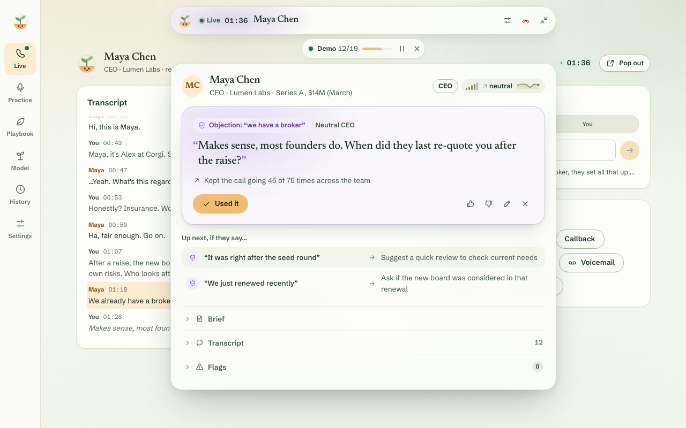
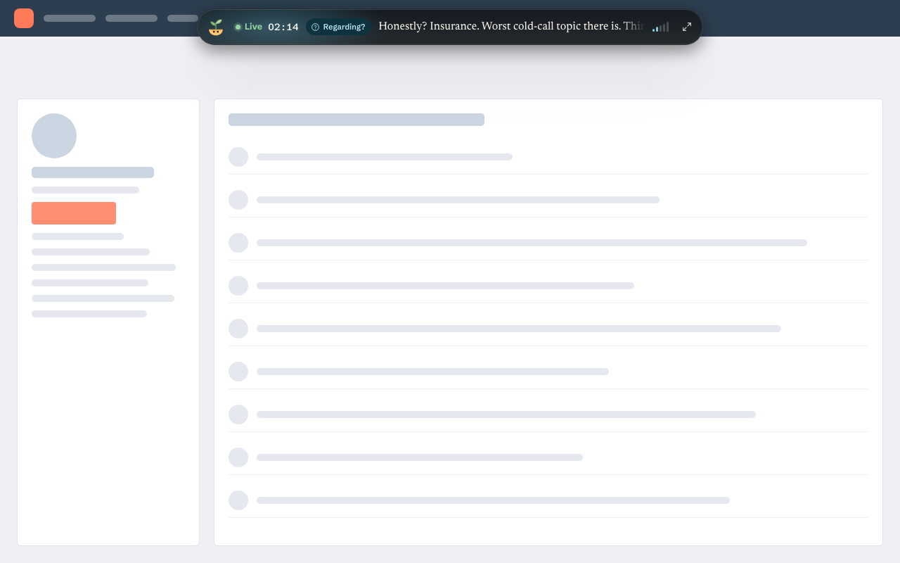
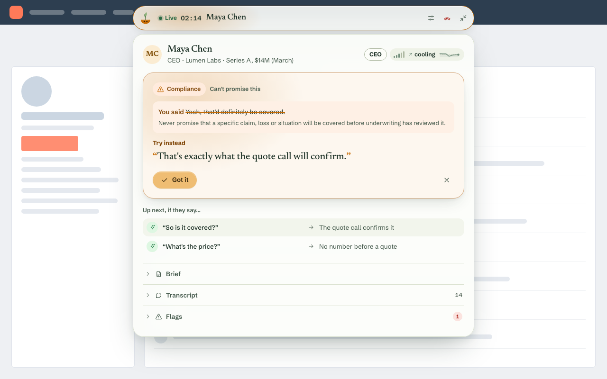
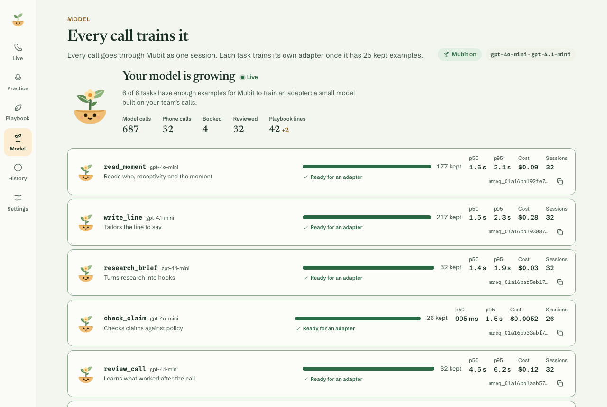
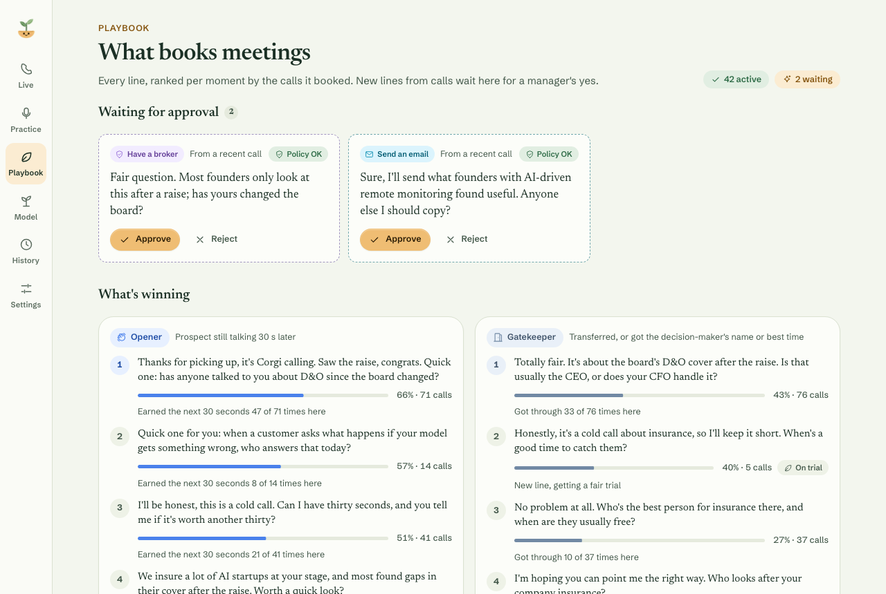
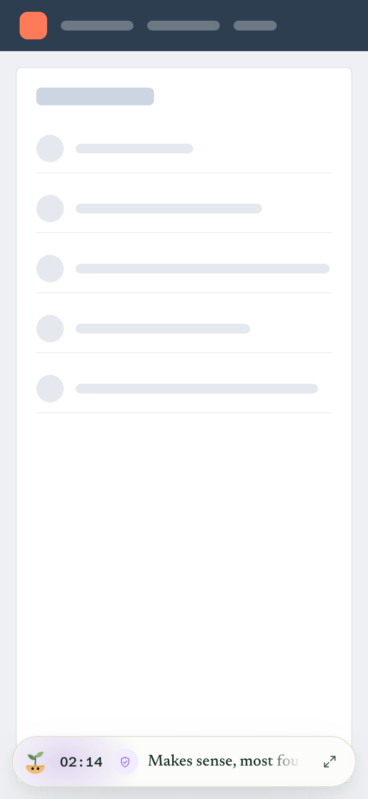

# Cue

**Know exactly what to say next on every cold call.**

Cue is a live suggestion overbar for BDRs. It floats over your dialer (Trellus, HubSpot, or anything
else) and reads the call as it happens. Every time the prospect speaks, it shows the one line most
likely to get you to a booked meeting, learned from every call your team has made. It runs as a
Chrome extension beside Trellus, or as its own app on a laptop or phone.

Every model call goes through **[Mubit](https://docs.mubit.ai)**. Cue is built from six small,
fixed, high-volume tasks, and every call ends in a fully labelled record. That gives Mubit what it
needs to turn the team's calls into task-adapted models that know what books meetings.

Product spec: [context.md](context.md) · System: [architecture.md](architecture.md) · Design system:
[docs/design/index.html](docs/design/index.html) (open it in a browser)

| | |
|---|---|
|  |  |
|  |  |
|  |  |

---

## 1. How it works

```
 Trellus call (tab audio)  ─┐                         HubSpot / CRM contact
 Rep mic (Web Speech)      ─┤                                 │
                            ▼                                 ▼
                 Live transcript (speaker-labelled)    research_brief  (Mubit, at dial time)
                            │                                 │ hooks
                            ▼                                 │
          read_moment (Mubit) → persona · receptivity · moment · tone
                            │
                            ▼
          Playbook bandit: top lines for this situation, ranked by meetings booked
                            │
                            ▼
          write_line (Mubit) ← hooks ─────────────────────────┘
                            │      (started speculatively in parallel with read_moment)
                            ▼
          check_claim (Mubit / Banyan Sapling) for anything risky
                            ▼
                   ✦ one card in the overbar  (~1.7 s median after the prospect stops)

 After the call: outcome (rep tap · Trellus disposition) + rep debrief
          → review_call (Mubit) on the full CallRecord → playbook stats + candidate lines
```

**The situation** = who (gatekeeper, CEO, CFO, engineer…) + how receptive they are (warm → cold) +
what just happened (16 moments: opener, gatekeeper, "what's this regarding?", brush-offs,
objections, buying signal, close, compliance…). Every suggestion and everything Cue learns is keyed
on it.

**The playbook** keeps per-situation stats for every line (shown, used, step wins, meetings booked,
lost) and ranks them with Thompson sampling: proven winners first, one slot for a new line to get a
fair trial. Reps' own lines that booked meetings come back as candidates for a manager to approve.

## 2. What Cue sends Mubit, and why it matters

Mubit groups calls with the same instructions, output format and model into a **task**, and trains an
**adapter** (a small model for that one job) once a task has 25 kept examples. Cue is designed around that:

| Task | When | Model | What it learns |
|---|---|---|---|
| `read_moment` | every prospect turn | gpt-4o-mini | Reading persona, receptivity, moment and tone from words and turn shape |
| `write_line` | every decision moment | gpt-4.1-mini | Picking and tailoring the line that wins here, given lines **with their win rates** |
| `research_brief` | call start | gpt-4.1-mini | Turning research into hooks for this prospect |
| `check_claim` | risky lines and rep claims | gpt-4o-mini | Sapling-style policy verdicts with a safe rephrase |
| `review_call` | after the call | gpt-4.1-mini | Judging a whole call the way this team does |
| `simulate_prospect` | practice mode, seeding | gpt-4o-mini | Playing realistic prospects |

- **One phone call = one Mubit session** (`prompt_cache_key = callId` on the Responses API).
- **Instructions never change per call**, so every call of a task lands in the same Mubit task.
  Everything call-specific is JSON in the input.
- **Every answer's `x-middleware-request-id` is stored** against the suggestion it produced and later
  against the call's outcome (`mubit_links`), ready for outcome-weighted training.
- **`review_call` reads the whole labelled call** (the `CallRecord`): transcript, the situation and
  tone timeline, every card with its latency and the rep's actions (used, dismissed, edited with their
  own words, thumbs), compliance flags, the outcome and where it came from (rep / Trellus / HubSpot,
  with raw disposition strings), and the rep's debrief: rating, the customer's attitude, what worked,
  what didn't, the line they wish they'd had. `GET /api/export.jsonl` exports the same records.
- **Corrections flow into the next calls.** An edited card, a thumbs-down, a better line in the
  debrief or a manager's approval changes the playbook, and the playbook is part of every `write_line`
  input. So the examples Mubit trains on keep getting better.

`pnpm seed:mubit` runs 30 simulated calls through the real pipeline (about 640 cheap model calls, ~$0.52),
then tops up `check_claim` with realistic rep claims, so every task passes the 25-example threshold
before a demo. The **Model** screen shows each task's progress, latency, cost
and last request id.

## 3. Repo

```
packages/core      @cue/core     taxonomy, zod contracts, call reducer, CallRecord, bandit, rules engine, Sprout states
packages/mubit     @cue/mubit    Mubit client (Responses API) and the six task definitions, evals
packages/trellus   @cue/trellus  Trellus Call Data API client, disposition mapping, outcome poller, backfill, native source
packages/client    @cue/client   browser API + SSE client, Web Speech transcriber, offline turn buffer
packages/ui        @cue/ui       design system: tokens, three directions, Sprout, primitives, the Overbar, gallery
apps/server        @cue/server   Hono + node:sqlite: the pipeline, review, practice, stats, export (holds all keys)
apps/web           @cue/web      standalone overbar app (PWA, Picture-in-Picture pop-out, demo mode)
apps/extension     @cue/extension Chrome MV3 (WXT): overlay on CRM pages, side panel, tab + mic capture
agents/            how the build was split into workstreams, and their contracts
docs/              design system page, provider doc snapshots
tests/e2e          Playwright across viewports, themes and directions
```

TypeScript end to end, so one set of zod schemas types the server, both clients and every model task.

## 4. Run it

Prerequisites: Node ≥ 22.13 (24 recommended), pnpm 10, Chrome.

```bash
pnpm i
cp .env.example .env          # add MUBIT_API_KEY (without it Cue runs on its rules engine, and says so)
pnpm dev                      # server on http://localhost:8787 + web app on http://localhost:5173
```

Open http://localhost:5173. **Run the demo** plays the context.md §11 call against the real server,
hands-free: gatekeeper → opener → the cold "what's this regarding?" → broker objection → a compliance
slip → buying signal → close → booked → debrief → the playbook updates. **Practice** lets you call a
simulated prospect. **Pop out** puts the overbar in an always-on-top Picture-in-Picture window over
any app.

Keyboard: `⌘/Ctrl + .` expand · `U` used it · `D` dismiss · `E` edit · `B` booked · hold `Space` to talk as the rep.

### Chrome extension

```bash
pnpm build:ext                # → apps/extension/.output/chrome-mv3
```

`chrome://extensions` → Developer mode → **Load unpacked** → `apps/extension/.output/chrome-mv3`.
Click the Cue icon to open the side panel → Settings: server URL (default `http://localhost:8787`),
token (if `CUE_API_TOKEN` is set), and optionally your Trellus key. Allow the microphone once.

On a HubSpot contact with Trellus, the overbar appears at the top of the page and offers **Start Cue**
when Trellus connects (or turn on auto-start). Click the Cue icon or press `Alt+Shift+C` on the call
tab so Chrome lets Cue hear the tab audio (a Chrome rule). `Alt+Shift+B` ends the call as booked.
Prospect transcription from tab audio needs `DEEPGRAM_API_KEY` on the server; without it, flip the mic
to "The prospect" or type their lines. `pnpm dev:ext` runs the extension with hot reload.

| Permission | Why |
|---|---|
| `sidePanel` | The expanded view docks beside the dialer |
| `storage` | Settings, the session and the offline turn buffer |
| `tabCapture` + `offscreen` | The prospect's voice is the call tab's audio; MV3 captures it in an offscreen document |
| `activeTab`, `scripting` | Capture starts on the tab where the rep invoked Cue; inject the overlay into already-open tabs |

### Connect Trellus (optional)

Trellus has no webhooks or streaming API, so Cue captures the live audio itself and reads outcomes and
history from the Trellus **Call Data API**.

1. In Trellus, open Settings → Integrations → API and copy your key (it inherits your permissions).
2. Give it to the server only: `TRELLUS_API_KEY=…` in `.env` (optional `TRELLUS_TEAM_ID`,
   `TRELLUS_POLL_SECONDS`), or paste it in Cue settings, which sends it to the server once.
3. `pnpm trellus:check` lists the readable reps and how each of your dispositions maps to a Cue
   outcome. Fix any unmapped ones in Settings → Dispositions.
4. After each call Cue polls Trellus for the matching session (dialled number, or name + company,
   within 10 minutes of the start) and records its disposition, keeping the raw strings.
5. Backfill: `pnpm --filter @cue/server seed --from-trellus` imports past connected calls with their
   transcripts, so Cue (and Mubit) learn from your history on day one.

No key? Cue runs **native**: its own call record, its own dispositions and a `tel:` dial link.

## 5. Checks

```bash
pnpm check          # typecheck + unit tests + builds, every package
pnpm test:e2e       # Playwright: design system, web app (320 → 1920 px, light/dark, all directions)
pnpm --filter @cue/extension e2e   # loads the built extension into Chromium on a hostile CRM fixture
pnpm test:live      # opt-in live Mubit tests (cheap models)
pnpm --filter @cue/mubit test:live -- eval   # read_moment eval: 26 labelled lines
```

What the tests cover, beyond units: contract parsing at every boundary; the reducer replaying any
event log to the same view; the bandit preferring winners while still exploring; Mubit retries,
`retry-after`, timeouts, aborts and the concurrency cap; superseded turns cancelled mid-flight; Mubit
failure falling back to the rules engine, labelled as such; 20 concurrent calls; SSE resume with
`Last-Event-ID`; offline turn buffering and replay; WCAG contrast for every moment colour in every
direction; no raw colours in components; no horizontal overflow or broken layouts with 200-character
names, 320-character lines, unbroken tokens, emoji and CJK at every viewport.

## 6. Environment

Every variable, with its default, is in [.env.example](.env.example).

| Variable | Purpose |
|---|---|
| `MUBIT_API_KEY` | Mubit key. Without it the server runs the rules engine and `/health` says so |
| `CUE_MODEL_FAST`, `CUE_MODEL_WRITE` | `gpt-4o-mini`, `gpt-4.1-mini` (both on Mubit's starter credit) |
| `CUE_MUBIT_CONCURRENCY`, `CUE_MUBIT_TIMEOUT_MS`, `CUE_MUBIT_RECORD` | Calls in flight, per-call deadline, `full` or `metadata` (keep no transcripts in Mubit) |
| `TRELLUS_API_KEY`, `TRELLUS_TEAM_ID`, `TRELLUS_POLL_SECONDS` | Trellus Call Data API |
| `DEEPGRAM_API_KEY`, `CUE_STT_TTL_SECONDS` | Tab-audio transcription in the extension (short-lived tokens) |
| `EXA_API_KEY` | Prospect research at dial time; without it the brief uses CRM facts |
| `SAPLING_URL` | Self-hosted Banyan Sapling; without it `check_claim` runs through Mubit |
| `CUE_PORT`, `CUE_DB_PATH`, `CUE_ALLOWED_ORIGINS`, `CUE_API_TOKEN` | Server |

## 7. Design

Three directions over one component set: **Honey** (Mubit's amber and sage, light and dark),
**Night Shift** (dark glass, for floating over any page) and **Signal** (high contrast for phones in
hand). The line is set in Newsreader, so what the rep says reads as speech, apart from the interface.
**Sprout**, the mascot, is the model growing on your calls: it listens, thinks, perks up with a card,
folds its leaves at a compliance slip, blooms when a meeting is booked, and grows a leaf per task as
Mubit gets closer to training an adapter. `pnpm --filter @cue/ui dev` opens the gallery with every
component in every state, a stress-string toggle and the demo call playback.

## 8. Privacy and limits

- Recording consent is the rep's responsibility (two-party consent in some US states and the UK).
  Cue reads receptivity from words and turn shape only, never voice biometrics, and never labels a
  person's emotions.
- Provider keys stay on the server. The extension stores no API keys.
- Mubit adapters are compared in Mubit's console (*Try models*); live serving of adapters from code is
  an open question for the Mubit team (context.md §13).
